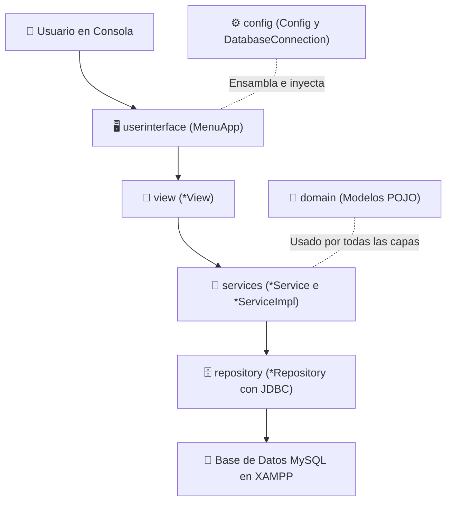

# 🏍️ Guía Rápida y Sencilla del Código: Health and Bike (Laboratorio)

Bienvenido a la guía exprés del proyecto. Aquí tienes todo lo necesario para entender y explicar el sistema en **5 minutos**, sin rodeos técnicos ni complicaciones.

---

## 💡 1. ¿Qué es este proyecto? (En 2 líneas)
Es una aplicación de consola en **Java puro (sin frameworks como Spring Boot)** que permite a moteros y administradores gestionar motocicletas, recordatorios de mantenimiento, talleres mecánicos y costos de arreglos, guardando toda la información de forma permanente en **MySQL (XAMPP)**.

---

## 🗺️ 2. El Mapa Mental: ¿Cómo está organizado el código?

El proyecto utiliza una **Arquitectura en Capas** donde cada carpeta tiene una única misión:

### ¿Qué hace cada carpeta?
1. **`Main.java`**: El interruptor de encendido. Verifica la conexión a MySQL e inicia el menú.
2. **`config/`**: El taller de ensamblaje.
   - `DatabaseConnection.java`: Conecta Java con MySQL en XAMPP (puerto `3307` o `3306`).
   - `Config.java`: Crea los objetos y los conecta entre sí (Patrón **Simple Factory** e **Inyección Manual de Dependencias**).
3. **`domain/`**: Las plantillas de los datos (Clases POJO con atributos privados, constructores y getters/setters).
4. **`repository/`**: Los encargados de la base de datos. Escriben y leen en MySQL usando sentencias SQL (`INSERT`, `SELECT`, `UPDATE`, `DELETE`).
5. **`services/`**: El cerebro del negocio. Contiene las reglas y valida la información antes de guardarla.
6. **`view/`**: La cara visual. Le pide datos al usuario por consola y muestra los resultados bonitos.
7. **`userinterface/`**: El menú interactivo (`MenuApp.java`) que guía al usuario con opciones numéricas.
8. **`utils/`**: Herramientas auxiliares, como `FormValidation.java` que evita que el programa se caiga si el usuario escribe letras en lugar de números.

---

## 🔄 3. El Viaje de un Dato (Ejemplo: Registrar una Moto)

Para explicar cómo funciona el flujo completo, sigue este camino:

1. **El usuario ingresa los datos:** En el menú selecciona "Registrar nueva moto". La clase `TipoMotoView` le pide marca, modelo, cilindraje, placa y año.
2. **Pasa al Servicio:** `TipoMotoView` le entrega los datos a `TipoMotoServiceImpl`. El servicio valida que el propietario exista.
3. **Pasa al Repositorio:** El servicio llama a `TipoMotoRepository.saveMoto(moto)`.
4. **Se guarda en XAMPP:** El repositorio abre una conexión con `DatabaseConnection`, prepara un `INSERT INTO tipos_moto ...` y lo ejecuta en MySQL.
5. **Confirmación:** La base de datos responde con el nuevo ID generado y la pantalla muestra: `✓ Moto registrada exitosamente`.

---

## 🎓 4. Los 4 Pilares de la Programación Orientada a Objetos (POO)

Si el profesor te pregunta en dónde se aplican los conceptos de POO, aquí tienes la respuesta exacta:

### 1. Herencia 👨‍👦
- **Dónde está:** En el paquete `domain`.
- **Ejemplo:** La clase base es `Person.java` (tiene `id`, `name`, `email`, `password`, `phone`).
  - `User.java` hace `extends Person` y añade atributos propios de un cliente (`role`, `address`, `balance`).
  - `Admin.java` hace `extends Person` y añade atributos de administración (`department`, `accessLevel`).
- **Por qué se hizo:** Evita repetir código común entre clientes y administradores.

### 2. Encapsulamiento 🔒
- **Dónde está:** En todas las clases de `domain`.
- **Ejemplo:** Todos los atributos son `private` o `protected` (nadie puede modificarlos desde afuera directamente).
- **Cómo se accede:** Únicamente a través de métodos controlados: `getId()`, `setId()`, `getBrand()`, etc.

### 3. Abstracción 📐
- **Dónde está:** En el paquete `services`.
- **Ejemplo:** Las interfaces como `TipoMotoService`, `UserService`, `HistorialService`.
- **Por qué se hizo:** La interfaz define **el QUÉ** debe hacerse (ej. `createMoto()`, `findMotoById()`) sin importar **el CÓMO**. La clase `TipoMotoServiceImpl` es la que tiene la implementación concreta.

### 4. Polimorfismo 🎭
- **Dónde está:**
  - En la sobreescritura del método `toString()` en cada clase de `domain` para imprimir la información con formato propio.
  - En el uso de interfaces: las vistas trabajan contra la interfaz `UserService`, permitiendo que la implementación interna cambie sin romper la vista.

---

## 🔌 5. ¿Cómo se conecta con XAMPP sin Spring Boot?

1. **El Driver:** En `pom.xml` se incluye la librería oficial `mysql-connector-j`.
2. **La Conexión (`DatabaseConnection.java`):**
   - Utiliza `DriverManager.getConnection()`.
   - Conecta a la base de datos `healthandbike_laboratorio`.
   - Detecta automáticamente el puerto `3307` de XAMPP (o `3306`).
   - Usa credenciales por defecto: usuario `root` y contraseña vacía `""`.
3. **El Script SQL:** El archivo `schema.sql` crea automáticamente las 9 tablas con sus relaciones de clave foránea (`FOREIGN KEY`).

---

## ⚡ 6. "Acordeón" de Preguntas Típicas del Profesor

| Pregunta del Profesor | Respuesta Rápida y Certera |
| :--- | :--- |
| **¿Por qué no usaron Spring Boot?** | Porque el requerimiento pedagógico era demostrar el dominio de **Java SE puro**, aplicando arquitectura por capas, POO, JDBC nativo y patrones de diseño manuales sin depender de la magia de frameworks. |
| **¿Qué patrón de diseño usaron para crear los objetos?** | El patrón **Simple Factory** centralizado en `Config.java`, el cual realiza **Inyección de Dependencias Manual** pasando repositorios a los servicios y servicios a las vistas. |
| **¿Dónde están las relaciones de base de datos?** | En las tablas de MySQL mediante `FOREIGN KEY` (ej. una moto apunta a un usuario, un estado apunta a una moto, y un arreglo apunta a un historial). En Java se representan con objetos anidados (ej. `TipoMoto` tiene un atributo `User user`). |
| **¿Cómo evitaron que el programa se caiga con entradas inválidas?** | Con la clase utilitaria `FormValidation.java`, que centraliza un único `Scanner(System.in)`, lee líneas completas y captura errores como `NumberFormatException`. |
